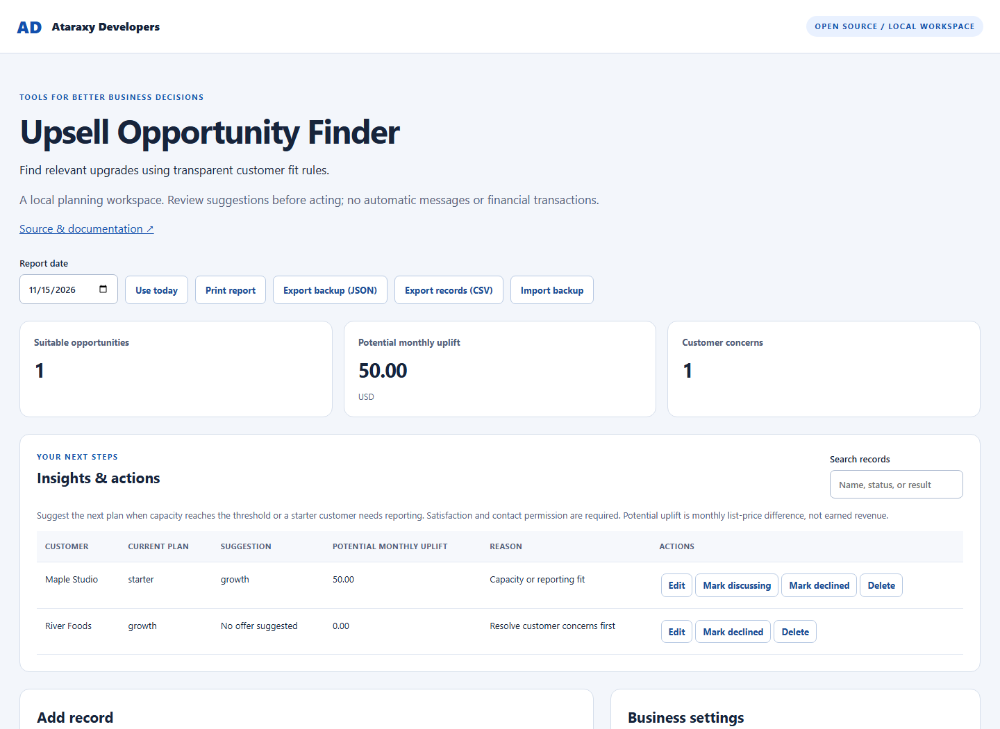

# Upsell Opportunity Finder

[](https://github.com/AtaraxyDevelopers/upsell-opportunity-finder/actions/workflows/ci.yml)
[MIT license](LICENSE) · Built by [Ataraxy Developers](https://ataraxydevelopers.com)

Find relevant upgrades using transparent customer fit rules.

A local planning workspace. Review suggestions before acting; no automatic messages or financial transactions.



## What you can do

- Add, edit, search and remove records through the browser.
- Adjust the business settings and report date; inspect calculations and suggested next steps.
- Save data locally across restarts; export a JSON backup or spreadsheet-safe CSV.
- Import a validated JSON workspace and run the same calculations from the command line.

## Get started

Prerequisites: **Node.js 22 or 24** (includes npm), a modern browser, and optionally Git. No API keys, paid services, database installation or runtime npm dependencies are needed. Development dependencies are used only for browser tests.

Clone:

```sh
git clone https://github.com/AtaraxyDevelopers/upsell-opportunity-finder.git
cd upsell-opportunity-finder
npm ci
npm test
npm run example
npm start
```

Or choose **Code → Download ZIP** on GitHub, extract the archive, open a terminal inside the extracted folder containing `package.json`, and run the commands beginning with `npm ci`. ZIP users do not need Git. On Windows PowerShell, use `npm.cmd` if execution policy blocks `npm`.

Open **http://127.0.0.1:4423** exactly as printed. Use this address instead of `localhost`; host validation is intentional. Stop with **Ctrl+C**. If Windows asks `Terminate batch job (Y/N)?`, press **Y**. If the port is busy, use `npm start -- --port 4623` and open the printed address.

The first run loads fictional sample records. It does not contact those businesses. The report initially uses **2026-11-15** so the example is repeatable; click **Use today** for current planning. Your selected report date is remembered in this browser and printed with the report. Edit a row, click **Save record**, and reload to verify persistence. When ready, export a backup, choose **Clear all records**, and enter your own records.

## Reproduce the example

```sh
npm run example
node scripts/analyze.mjs --input examples/workspace.json --date 2026-11-15 --out report.json
```

Expected summary:

| Metric                   | Value |
| ------------------------ | ----- |
| Suitable opportunities   | 1     |
| Potential monthly uplift | 50.00 |
| Customer concerns        | 1     |

The command writes UTF-8 JSON. `--out` refuses to overwrite an existing file; choose another filename on subsequent runs. Running without `--out` prints JSON. Unknown flags, invalid dates and invalid data exit with a nonzero status.

## Worked follow-up example

Flag a customer concern before proposing an upgrade. The script changes only a copy of the fictional sample data and checks the result. It sends no messages and records no actual payment or sale.

```sh
npm run walkthrough
```

Expected output: **Suitable opportunities: 0**. See [examples/walkthrough.mjs](examples/walkthrough.mjs) for the exact input change.

## How the calculation works

Suggest the next plan when capacity reaches the threshold or a starter customer needs reporting. Satisfaction and contact permission are required. Potential uplift is monthly list-price difference, not earned revenue.

Money uses two decimal places, with half-cent ties rounded away from zero, and one consistent currency per workspace. This is a planning tool, not an accounting ledger, tax engine, automated credit decision system, or guarantee of business results. Review the inputs and assumptions before acting. Zero-denominator rates show N/A rather than an invented percentage. Dates are UTC calendar dates.

## Try the main workflow

1. Start the app and open its printed address.
2. Export the fictional sample workspace using **Export backup (JSON)**.
3. Choose **Clear all records** and confirm. Fill the required fields under **Add record** using the first record in `examples/workspace.json`; optional fields can stay empty. Click **Save record**.
4. Edit the record, save, and reload. Saved values should remain.
5. Import the sample backup and confirm replacement. Both original sample rows should return.
6. Stop with **Ctrl+C**, restart, and verify the saved workspace returns. Use a real date and business settings before making decisions from your own data.

## Data format

See [examples/workspace.json](examples/workspace.json) for a complete importable file. It contains `schemaVersion: 1`, `project: "upsell-opportunity-finder"`, `settings`, and `records`. Every record needs a unique `id` (letters, digits, hyphens or underscores). Numeric fields must be JSON numbers, flags must be booleans, and dates must be real `YYYY-MM-DD` dates.

| Field            | Meaning                   | Type / allowed values                              |
| ---------------- | ------------------------- | -------------------------------------------------- |
| `name`           | Customer / business name  | text                                               |
| `email`          | Customer email            | email                                              |
| `plan`           | Current plan              | select: starter, growth, scale                     |
| `utilization`    | Current capacity used (%) | number                                             |
| `needsReporting` | Needs advanced reporting  | boolean                                            |
| `healthy`        | Customer is satisfied     | boolean                                            |
| `consent`        | Permission for offers     | boolean                                            |
| `status`         | Opportunity status        | select: unreviewed, discussing, accepted, declined |

Import replaces the current workspace after confirmation; export a backup first. The entire import is validated before any existing data is changed. Maximum import size: 2 MB / 10,000 records. Saves also check the formatted backup size so an accepted workspace can be exported and re-imported. CSV is for export; JSON is the lossless import and backup format.

## Storage, backup and restore

Saved data lives at `data/workspace.json`, relative to the project folder, and is excluded from Git. Each save writes a temporary file before replacing the data file. Only one process may use a data file at a time; stale tabs are rejected instead of overwriting newer edits.

Use **Export backup (JSON)** and **Import backup** for backup and restore. **Download record draft** and **Download settings draft** preserve a valid unsaved form when a save conflicts with another tab. A draft contains a workspace snapshot, not just one changed field: compare it with the latest backup before importing so you do not replace newer work. Finish editing or clear the form before applying a row action. You can also stop the app, copy the data file to a safe location, and restore it while stopped. To choose another location:

```sh
npm start -- --data ./data/another-workspace.json
```

For a temporary demo that writes no customer data (the UI labels it as temporary; export before stopping if you want to keep your changes):

```sh
npm start -- --memory
```

If a crash leaves `workspace.json.lock`, first make sure no instance is running against that file, then remove only the corresponding `.lock` file and restart. An invalid data file is reported; it is never silently replaced with sample data.

## Test

```sh
npm test
npm run browser:install
npm run test:browser
```

The Node tests check documented calculations, business edge cases, invalid imports, HTTP controls, persistence and stale-write protection. Playwright tests exercise editing, saving, reload, downloads, invalid imports, mobile layout and automated WCAG checks. Browser tests use a separate port and temporary in-memory data. Automated accessibility checks are useful coverage, not a claim of complete accessibility certification. CI runs Node tests and examples on Windows, macOS and Linux with Node 22 and 24, plus Chromium tests on Linux.

## Extend or integrate

The pure `analyze(records, settings, asOf)` function is in [src/domain.mjs](src/domain.mjs). Validate external data with `validateState` from [src/lib.mjs](src/lib.mjs) before calling it. [docs/API.md](docs/API.md) describes the local HTTP interface and a runnable client example.

This release is deliberately a single-user local app. Public hosting, shared-team authentication, scheduled email delivery and vendor integrations require additional implementation. See [SECURITY.md](SECURITY.md) before changing the deployment model.

## Update an existing installation

Export a JSON backup, stop the old server, and keep the backup outside the project folder. For a Git checkout, pull the latest `main` and run `npm ci`. For a ZIP install, extract the new release into a new folder, run `npm ci`, start it, and import the backup. Version 0.1.1 keeps the version-1 workspace format; existing backups remain compatible. Keep the old folder until the restored data is checked.

## Contribute

Read [CONTRIBUTING.md](CONTRIBUTING.md), report reproducible issues with synthetic data, and keep customer records out of public issues. MIT licensed; you may use, modify and redistribute the software under the license terms.
